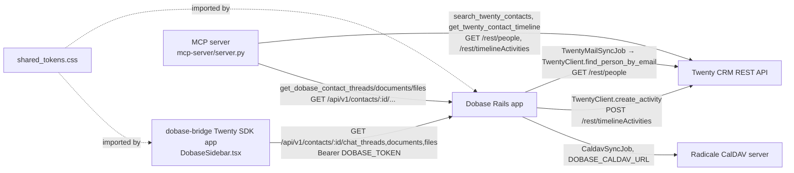

Notes on edges not obvious from the diagram alone:

- The MCP server (`mcp-server/server.py`) talks to **both** Twenty and Dobase directly with its own `httpx` clients and its own `TWENTY_API_KEY`/`DOBASE_API_TOKEN` — it does not go through the Rails `dobase/` layer to reach Twenty. This means Twenty credentials are configured twice in this system (once in `dobase/`, once in `mcp-server/`), each read from its own env var pair.
- `Dobase` is the only layer with a CalDAV edge; the SDK app and MCP server only ever see Dobase's `/api/v1/contacts/:id/...` REST endpoints (routes defined in `dobase/config/routes_snippet.rb`), which are currently stubbed to return `[]` — see [[overview]].
- `shared_tokens.css` has no runtime edge — it's a static file consumed via copy/symlink (Dobase) or `@import` (Twenty core, not in this repo) or `var(--token-name)` (SDK app inline styles).

Diverges from `mcp-server/README.md`: the README's "Architecture note" states "Twenty's native MCP server handles CRM reads/writes. This server handles Dobase communication data." — but `server.py` itself defines `search_twenty_contacts` and `get_twenty_contact_timeline`, which call Twenty's REST API directly (`mcp-server/server.py:28-52`). This server is not limited to Dobase data.
