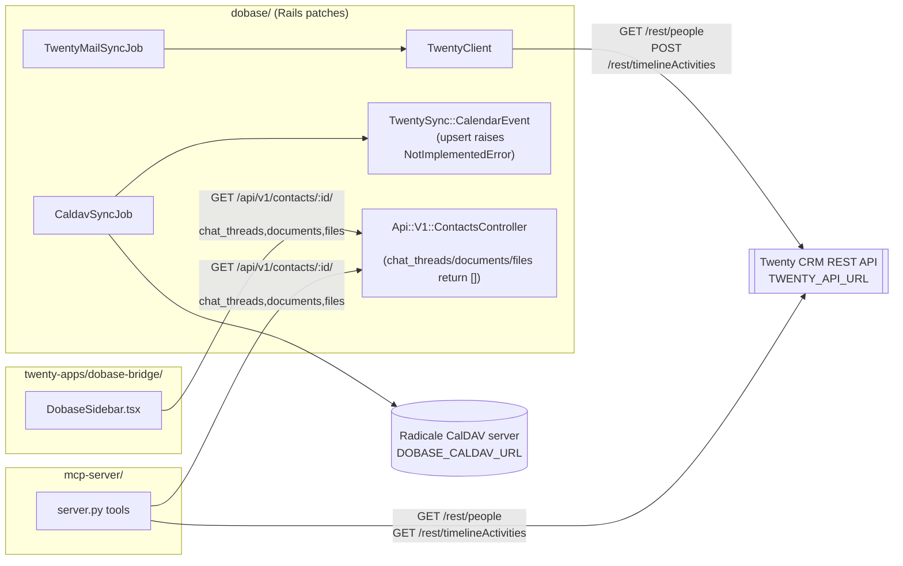

## Non-obvious edges

- `CaldavJob → CE` exists structurally but `CalendarEvent.upsert` always raises, so no
  CalDAV event ever actually reaches Twenty yet.
- `Sidebar → Ctrl` and `MCP → Ctrl` hit the exact same three Dobase endpoints
  independently (React fetch vs Python httpx) — there is no shared client between them.
- `TC → Twenty` and `MCP → Twenty` both parse the same nested shape,
  `resp.json()["data"]["<type>"]["edges"][*]["node"]`, independently in Ruby and Python.
  See [[gotchas]] for why this matters if Twenty's API response shape ever changes.
- `shared/design-tokens/shared_tokens.css` is not shown above because it has no runtime
  HTTP edge — it's a static asset each side is expected to copy/`@import` manually.
