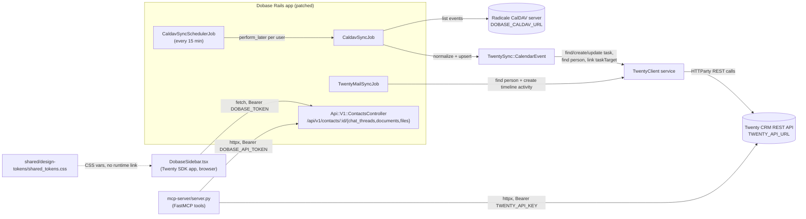

## Non-obvious edges

- `ContactsAPI` is currently a stub: `chat_threads`, `documents`, and `files` all `render json: []` (marked `# TODO: DEV-114/115/116` in [dobase/app/controllers/api/v1/contacts_controller.rb](../../dobase/app/controllers/api/v1/contacts_controller.rb)). Both consumers of this endpoint — `DobaseSidebar.tsx` and the three `get_dobase_contact_*` MCP tools in `mcp-server/server.py` — will always get an empty list until those handlers are implemented. See [knowledge/gotchas.md](gotchas.md).
- `mcp-server/server.py` talks to Twenty's REST API directly (not through `TwentyClient`, which is Ruby-only) — it has its own `httpx`-based auth headers (`_twenty_headers`, `_dobase_headers`).
- `shared_tokens.css` has no build-time or runtime import in this repo; both host apps are expected to copy/symlink/`@import` it per [shared/design-tokens/README.md](../../shared/design-tokens/README.md) — there's no code here that wires it up.
- `TwentySync::CalendarEvent.link_contact` only tries to match the **first** attendee email that resolves to a Twenty person (`person_for` returns on first match, order = `attendee_emails` array order from the iCal `ATTENDEE` lines) — if the organizer is listed before the actual counterparty, the task could get linked to the wrong (or no) person.
